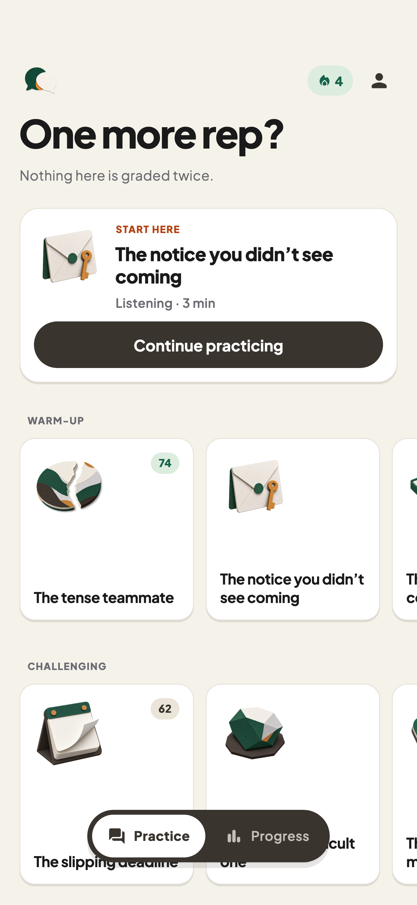
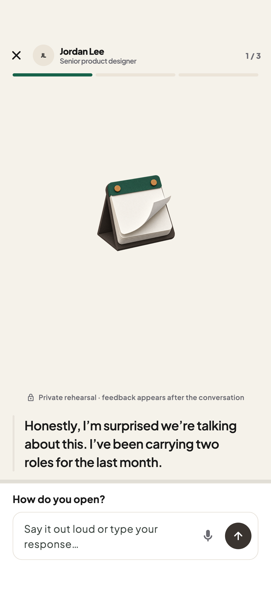
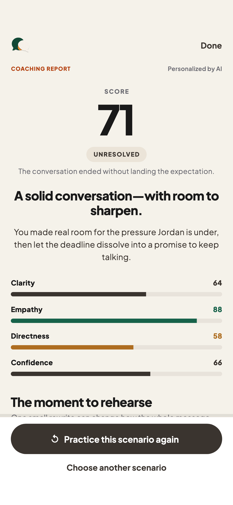
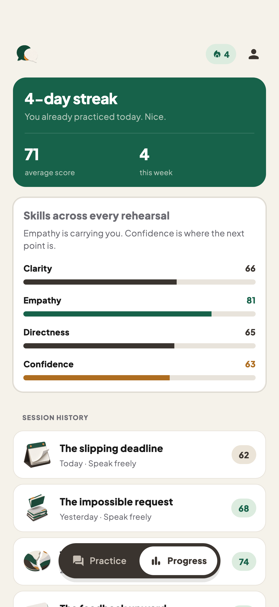
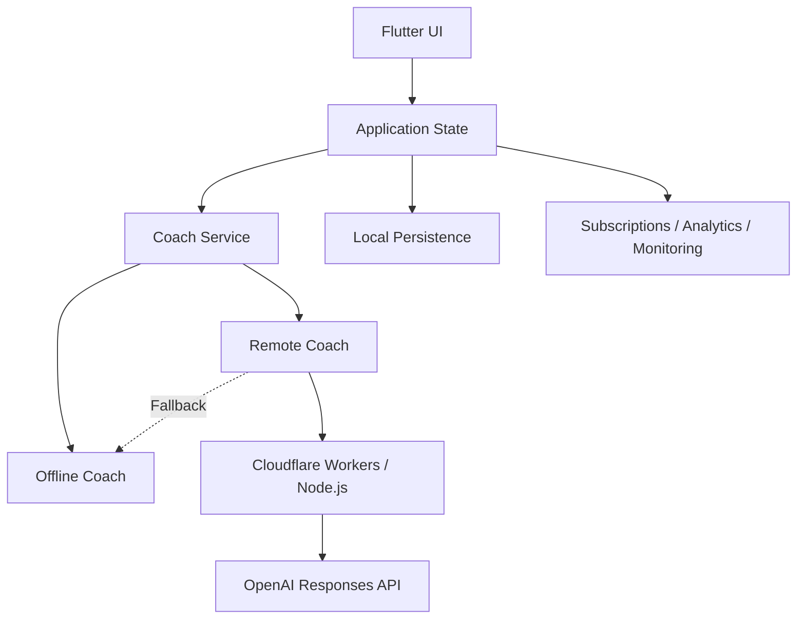

<div align="center">
  
  <h1>Rehearse</h1>
  <p><strong>Practice the difficult conversation before it matters.</strong></p>
  <p>Flutter · iOS · Android · Web</p>
  <p><a href="https://apps.apple.com/us/app/rehearse-conversation-coach/id6808087516">Available on the App Store</a></p>
</div>

Rehearse is a conversation practice app that helps new managers
build confidence in difficult workplace conversations through
interactive simulations and actionable coaching.

Originally built for RevenueCat Shipaton 2026.

<p align="center">
  
  
  
  
</p>

## Features

- **Scenario library:** 12 curated workplace conversations,
  including feedback, delegation, conflict, and boundary setting.
- **Interactive practice:** guided choices or free-form responses
  with adjustable difficulty and resistance.
- **Voice interaction:** speech recognition and spoken replies.
- **Personalized coaching:** feedback on clarity, empathy,
  directness, and confidence, grounded in the user's responses.
- **Progress tracking:** practice streaks, skill averages,
  session history, and personal bests.
- **Offline practice:** a fully functional demo without
  API keys or a network connection.

## Engineering highlights

### Resilient AI integration

Conversation simulation and evaluation are separate model tasks.
Structured responses are validated on both the server and client,
and coaching quotes are checked against the original transcript.

When the remote coach is unavailable, an on-device coach
provides a fallback without interrupting the practice flow.

### Privacy by design

Practice history is stored locally. Analytics interfaces accept
only predefined identifiers, enums, numbers, and booleans,
rather than conversation text.

Crash reporting is configured to avoid capturing sensitive
practice content. AI requests are handled by a server-side proxy,
keeping the provider API key out of the client.

### Product infrastructure

RevenueCat handles subscriptions, dynamic offerings,
purchase restoration, and entitlement updates.

PostHog supports product analytics through a provider-independent
interface, while Sentry handles error monitoring.
All integrations are optional in local development.

### Design and quality

A custom Material 3 design system, reusable components,
bundled typography, and a consistent illustration library.

Automated tests cover product behavior, accessibility,
subscription states, coaching responses, and server validation.
Store screenshots are generated directly from the Flutter UI.

## Architecture



## Tech stack

**Application:** Flutter, Dart, Material 3

**Backend:** Node.js, Cloudflare Workers, OpenAI Responses API

**Product infrastructure:** RevenueCat, PostHog, Sentry

**Local storage:** SharedPreferences

## Getting started

Requires Flutter with Dart 3.12 or compatible SDK,
and a configured target platform.

```bash
flutter pub get
flutter run
```

The app runs in offline demo mode by default.
No API keys, accounts, or backend configuration are required.

### Optional AI integration

To enable remote coaching, run your own local server
with Node.js 20 or later.

Set your own `OPENAI_API_KEY` in the server environment,
then start the server:

```bash
cd server
npm start
```

From the project root, in another terminal:

```bash
flutter run \
  --dart-define=REHEARSE_COACH_URL=http://127.0.0.1:8787
```

For Android emulators, use `10.0.2.2` instead of
`127.0.0.1` and configure the local server to accept
emulator connections.

Production credentials and deployment configuration
are intentionally excluded from this repository.

## Testing

```bash
flutter analyze
flutter test
cd server && npm test
```

### Generate screenshots

```bash
flutter test tool/generate_screenshots.dart
```

Screenshots are rendered from the actual app with seeded demo data.

## Documentation

- [Architecture](docs/ARCHITECTURE.md)
- [Product requirements](docs/PRD.md)
- [Analytics](docs/ANALYTICS.md)
- [Subscription integration](docs/REVENUECAT.md)
- [Implementation history](docs/STATUS.md)

The documentation also preserves the project's original
development decisions and historical implementation notes.
